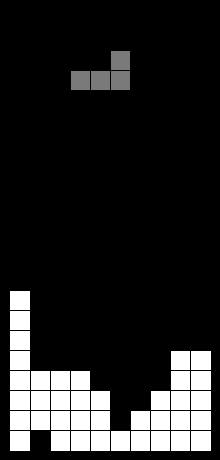

# 結合 CNN 的 MCTS 搜尋在 Tetris 上的表現 (Tetris AI)

國立東華大學資訊工程學系 113 學年度畢業專題研究。  
本專題受 AlphaGo 架構啟發，探討結合卷積神經網路 (CNN) 與蒙地卡羅樹搜尋 (MCTS) 在俄羅斯方塊 (Tetris) 中的即時決策與局面評估表現。

---

## 運行預覽



---

## 專案方法與架構

1. **Bitmask 盤面表示法**
   - 將 20x10 盤面每行壓縮為 10-bit 整數（`0b0000000000` ~ `0b1111111111`）。
   - 利用位元 AND 運算進行碰撞檢測，全滿列（1023）即完成消行，大幅提升樹搜尋模擬速度。

2. **雙頭卷積神經網路 (Dual-Head CNN)**
   - 輸入為 20x10 盤面（包含頂部緩衝區）。
   - 經卷積層提取特徵後，全連接層輸出兩個分支：
     - **Value Head**：評估盤面未來的預期得分/潛在價值。
     - **Variance Head**：評估該預測的不確定性（Variance）。

3. **CLT-UCB 搜尋策略**
   - 結合中央極限定理（Central Limit Theorem, CLT）：
     $$\text{UCB} = \text{Value}_{\text{CNN}} + c \cdot \text{Quantile}(N) \cdot \frac{\sigma}{\sqrt{N}}$$
   - 初始時模型變異數較高，系統偏向探索；隨信心提升與節點訪問增加，探索項收斂，引導樹搜尋走向高期望、低風險的走法。

---

## 實驗結果

消行數到達 100 / 200 / 300 行時的表現比較：

| 演算法 | 模擬次數 / 步 | 100 行得分 | 200 行得分 | 300 行得分 (方塊數) |
| :--- | :---: | :---: | :---: | :---: |
| 純 MCTS (Baseline) | 10,000 | 18,930 | 36,790 | 54,520 (783 塊) |
| 純 MCTS (加入高度懲罰) | 10,000 | 19,290 | 37,470 | 55,800 (759 塊) |
| **CNN + MCTS (Ours)** | **100** | **22,090** | **43,722** | **64,682 (817 塊)** |

在相同的消除行數下，結合 CNN 的 MCTS 系統獲得的分數高於純 MCTS；且 CNN+MCTS 僅需 100 次模擬即可達到純 MCTS 模擬 10,000 次的效果，顯著降低計算開銷。

---

## 目錄結構

```
├── results/                   # 實驗數據與預訓練模型權重 (online-200sims)
├── src/
│   ├── engine.py              # Bitmask 盤面物理模擬與啟發式特徵
│   ├── cnn_evaluator.py       # PyTorch CNN 模型推論
│   ├── mcts_agent.py          # MCTS 決策代理 (支援 UCB1 與 CLT-UCB)
│   ├── mcts.py                # 原始 MCTS 實作
│   └── interface.py           # TETR.IO 自動化連線模組
├── run_demo.py                # 終端展示與基準測試腳本
└── requirements.txt
```

---

## 快速開始

### 環境需求
- Python 3.8+
- PyTorch, NumPy

```bash
pip install -r requirements.txt
pip install torch
```

### 執行展示

```bash
# 運行 CNN-MCTS 展示
python run_demo.py --mode cnn_mcts

# 運行純 MCTS 展示
python run_demo.py --mode pure_mcts

# 執行雙引擎基準對比測試 (各消 100 行)
python run_demo.py --mode benchmark --target-lines 100
```
